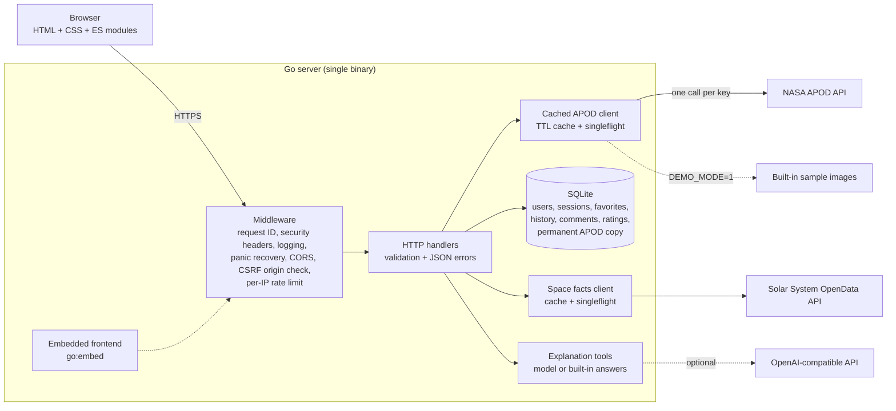

# NASA APOD Explorer

[](https://github.com/magic-peach/NASA-APOD-Explorer/actions/workflows/ci.yml)
[](LICENSE)

Browse three decades of NASA's Astronomy Picture of the Day, served by a Go backend that fetches each picture from NASA once and serves every later request from its cache.

**Live demo:** <https://apod-explorer-magicpeach.fly.dev> (runs in demo mode while NASA's APOD API returns placeholders; it sleeps when idle, so the first visit can take a few seconds)

<!-- Screenshot placeholder: add docs/images/screenshot.png (or a short GIF of
     the gallery and viewer) and replace this comment with:
      -->

---

## Contents

- [Features](#features)
- [Architecture](#architecture)
- [Quick start](#quick-start)
- [API reference](#api-reference)
- [Configuration](#configuration)
- [Testing](#testing)
- [CI/CD and deployment](#cicd-and-deployment)
- [Design decisions](#design-decisions)
- [Known limitations](#known-limitations)
- [Future work](#future-work)

## Features

**Exploring**
- Today's picture front and centre, with an "on this day" strip showing the same date in earlier years.
- A masonry gallery of random days with infinite scroll, plus search by day, by date range (up to 30 days) or by year.
- A full-screen viewer with ←/→/Esc keyboard control, HD toggle, credit line and "copy link".
- Shareable deep links: `/?date=YYYY-MM-DD` opens that picture directly.
- Video entries play inline: YouTube via its privacy-enhanced domain, Vimeo, and direct video files.

**Accounts**
- Sign up and log in with bcrypt-hashed passwords and HTTP-only session cookies.
- Favorites sync to your account, or are kept in the browser when you're logged out and moved to your account when you log in.
- Viewing history, star ratings and comments.
- Explanation tools for each picture (explain for beginners or experts, ask a question, quiz, mini lesson, and more). They use an OpenAI-compatible model if one is configured, and built-in answers otherwise.

**Production qualities**
- Concurrency-safe TTL cache with `singleflight`, so 100 simultaneous requests for one uncached picture make exactly one call to NASA.
- Graceful shutdown, explicit server timeouts, per-IP rate limiting, same-origin CORS, a strict Content-Security-Policy, and request-ID'd structured logs.
- Input validation with one consistent JSON error shape.
- Ships as one ~21 MB distroless container with health checks; SQLite with versioned migrations.
- Accessible frontend: keyboard navigation, focus management, live regions, and respect for `prefers-reduced-motion`.

## Architecture



A request for one day's picture checks three layers in order:

1. **The permanent SQLite copy.** A past date's entry never changes.
2. **The in-memory TTL cache.**
3. **NASA.** Concurrent misses for the same key share a single upstream call through `singleflight`.

[`docs/ARCHITECTURE.md`](docs/ARCHITECTURE.md) walks through the request lifecycle, the cache stampede problem, the concurrency model, graceful shutdown and the security choices.

```
cmd/server/          entry point: config, wiring, http.Server, graceful shutdown, healthcheck
internal/apod/       NASA client, cached + singleflight decorator, placeholder detection, demo client
internal/cache/      generic concurrency-safe TTL cache with a janitor goroutine
internal/config/     environment-variable configuration with validation
internal/httpapi/    handlers, middleware, validation, auth and sessions
internal/store/      SQLite via database/sql, embedded SQL migrations
internal/spacefacts/ solar-system facts client
internal/llm/        explanation tools with offline fallbacks
web/                 embedded frontend (no build step)
ops/                 optional Airflow DAG and n8n workflow
```

## Quick start

**Run locally** (Go 1.24+):

```sh
git clone https://github.com/magic-peach/NASA-APOD-Explorer.git
cd NASA-APOD-Explorer
make demo        # built-in sample images; no keys needed
# or, with real data:
cp .env.example .env    # add your keys (see docs/DEPLOYMENT.md)
set -a; source .env; set +a
make run
```

Open <http://localhost:8080>.

**Run with Docker:**

```sh
docker compose up --build    # SQLite is kept in a named volume
```

> NASA's APOD API is currently returning placeholder content for most dates (see [Known limitations](#known-limitations)). Use `make demo` / `DEMO_MODE=1` to see the app with real images.

## API reference

All responses are JSON. Errors always look like this:

```json
{ "error": { "code": "invalid_date", "message": "date must not be in the future" } }
```

| Method | Path | Auth | Description |
|---|---|---|---|
| GET | `/api/apod` | | Today's entry. Or `?date=YYYY-MM-DD` (one entry), `?start_date=&end_date=` (up to 30 days), `?count=1..10` (random). Single entries are an object; ranges and counts are arrays. |
| GET | `/api/apod/on-this-day` | | The same date in previous years: `?date=` (default today), `?years=1..10` (default 5). |
| GET | `/api/space-facts` | | Planets, moons, average gravity and radius. |
| POST | `/api/llm` | | Explanation tools: `{ "task": "eli10", "title": "...", "explanation": "..." }`. |
| POST | `/api/auth/signup` | | `{ "username", "email", "password" }`. Creates the account and logs in (201). |
| POST | `/api/auth/login` | | `{ "username", "password" }`. The username field also accepts an email address. Sets the session cookie. |
| POST | `/api/auth/logout` | | Deletes the session server-side (204). |
| GET | `/api/auth/me` | ✓ | The logged-in user. |
| GET | `/api/favorites` | ✓ | Your favorites, newest first. |
| POST | `/api/favorites` | ✓ | `{ "date", "title", "url" }`. An upsert, so saving twice never duplicates. |
| DELETE | `/api/favorites/{date}` | ✓ | Remove a favorite (204, or 404 if not yours). |
| GET | `/api/history` | ✓ | Your 30 most recent views. |
| POST | `/api/history` | ✓ | Record a view: `{ "date", "title" }`. |
| GET | `/api/comments?date=` | | Comments on a date. |
| POST | `/api/comments?date=` | ✓ | `{ "comment" }`, 1–2000 characters. |
| GET | `/api/ratings?date=` | | Average rating. |
| POST | `/api/ratings?date=` | ✓ | `{ "rating": 1..5 }`. Re-rating replaces your previous rating. |
| GET | `/healthz` | | Liveness: the process is up. |
| GET | `/readyz` | | Readiness: the database answers (503 if not). |

Dates must be real `YYYY-MM-DD` dates, no earlier than 1995-06-16 and no later than today in US Eastern time. POST bodies must be `application/json`, and unknown fields are rejected.

## Configuration

Everything is set with environment variables; [`.env.example`](.env.example) lists them all. Where to get each key is in [`docs/DEPLOYMENT.md`](docs/DEPLOYMENT.md#1-get-the-keys-and-secrets).

| Variable | Default | Purpose |
|---|---|---|
| `PORT` | `8080` | HTTP port |
| `NASA_API_KEY` | `DEMO_KEY` | NASA API key (the default is heavily rate-limited) |
| `SESSION_SECRET` | random per process | HMAC key for stored session tokens, at least 32 characters. Set it in production, or restarts log everyone out. |
| `DB_PATH` | `app.db` | SQLite database file |
| `CACHE_TTL` | `10m` | How long upstream responses stay in memory |
| `DEMO_MODE` | `false` | Serve built-in sample images instead of calling NASA |
| `SOLAR_SYSTEM_API_KEY` | | Enables the space-facts panel |
| `OPENAI_API_KEY` | | Live answers for the explanation tools |
| `LLM_MODEL` / `LLM_BASE_URL` | `gpt-4o-mini` / OpenAI | Model and endpoint for those answers |
| `SESSION_TTL` | `720h` | How long a login lasts |
| `COOKIE_SECURE` | `true` | `Secure` flag on the session cookie |
| `RATE_LIMIT_RPS` / `RATE_LIMIT_BURST` | `5` / `20` | Per-IP token bucket for `/api/` |
| `APP_ORIGIN` | | One extra origin allowed by CORS (default: same-origin only) |
| `TRUSTED_PROXY_HEADER` | | Header with the real client IP behind a proxy, e.g. `Fly-Client-IP` |
| `LOG_FORMAT` | `text` | `text` or `json` |
| `APP_SALT` | `nasa-apod-salt` | Only used to verify passwords from before bcrypt (they're upgraded on login) |

## Testing

```sh
make test     # go test ./...
make race     # go test -race ./...
make cover    # coverage report (coverage.html); CI shows the total, currently 69.2%
make bench    # cache and singleflight benchmarks
make lint     # gofmt check, go vet, golangci-lint
```

The key concurrency test fires 100 goroutines at one uncached key against a slow fake upstream. It asserts NASA is called **exactly once** and all 100 callers receive the same result. A cache-only baseline makes 100 calls under the same load:

```
BenchmarkStampede/with_singleflight   1.000 upstream-calls/op
BenchmarkStampede/cache_only          99.99 upstream-calls/op
```

[`docs/TESTING.md`](docs/TESTING.md) covers what each test proves, how to read the race detector's output, and how to run and interpret the benchmarks.

## CI/CD and deployment

[GitHub Actions](.github/workflows/ci.yml) runs on every push and pull request:

1. **Lint:** `gofmt`, `go vet`, `golangci-lint`.
2. **Test:** `go test -race` with coverage.
3. **Docker build.**
4. **Deploy:** pushes to `main` deploy to Fly.io once all three pass.

The app runs on [Fly.io](fly.toml) with a persistent volume for SQLite, HTTPS and health checks. [`docs/DEPLOYMENT.md`](docs/DEPLOYMENT.md) has the exact commands.

There are also optional integrations, described in [`docs/INTEGRATIONS.md`](docs/INTEGRATIONS.md): a [Jenkinsfile](Jenkinsfile) mirroring CI, an [Airflow DAG](ops/airflow/apod_daily_dag.py) that pre-warms and archives each day's picture, and an [n8n workflow](ops/n8n/daily-apod-digest.json) that posts it to Discord or email.

## Design decisions

- **Standard library first.**
  - `net/http` with Go 1.22's method-aware routing, `log/slog` for logging, `database/sql`.
  - Dependencies are limited to `golang.org/x/{sync,time,crypto}` and a SQLite driver.
- **Interfaces are declared by the consumer.** Handlers depend on small interfaces (`APODClient`, `FactsClient`, `Assistant`) declared in `httpapi`, so tests swap in fakes with no network. The real client, the cached decorator and the demo client all satisfy the same interface.
- **`singleflight` over "just a cache".** A cache alone still stampedes on a miss. The shared fetch is deliberately detached from the first caller's context (`context.WithoutCancel` + timeout), so one user closing a tab can't fail everyone else's request.
- **Pure-Go SQLite** (`modernc.org/sqlite`).
  - No CGO, so the binary is static and the runtime image can be distroless.
  - SQLite is plenty for a single-instance app; migrations are plain `.sql` files embedded in the binary.
- **Sessions in cookies, not `localStorage`.**
  - `HttpOnly` stops page scripts (and so XSS) from reading the token; `SameSite=Lax` plus an Origin check stop cross-site writes.
  - Only an HMAC of the token is stored, so a leaked database isn't a list of live sessions.
- **No frontend build step.** Native ES modules, `<dialog>`, `popover` and CSS columns cover what a framework would have been used for, and the strict CSP (`script-src 'self'`) is possible because nothing is inline.
- **Fail visibly, not silently.** NASA placeholder entries are detected and never stored permanently; upstream timeouts become 504s with a clear message; every UI fetch has an error state with retry.

## Known limitations

- **NASA's APOD API is returning placeholders.**
  - APOD moved to `science.nasa.gov`, and `api.nasa.gov/planetary/apod` now answers most dates with the site's generic "NASA Science" page.
  - The app detects these and shows a notice. `DEMO_MODE=1` serves built-in public-domain sample images until NASA fixes the API.
- **Single instance only.**
  - SQLite and the in-memory caches, sessions purge and rate limiter live in one process.
  - Running several instances would need a shared database and a shared rate-limit store.
- **The rate limiter is per process and in memory.** Limits reset on restart.
- **No email verification or password reset** for accounts.
- **Explanation tools without a configured model give generic built-in answers**, not answers specific to the picture.

## Future work

- Swap SQLite for Postgres (or replicate it with LiteFS) to allow more than one instance.
- Fall back to a second data source for APOD while NASA's API is broken.
- Password reset and email verification.
- Full-text search over titles and explanations (SQLite FTS5).
- Browser end-to-end tests (Playwright) in CI, alongside the Go tests.
- Prometheus metrics: cache hit rate, singleflight shared-call rate, upstream latency.

## License

[MIT](LICENSE). APOD images and text belong to NASA and the credited photographers.
