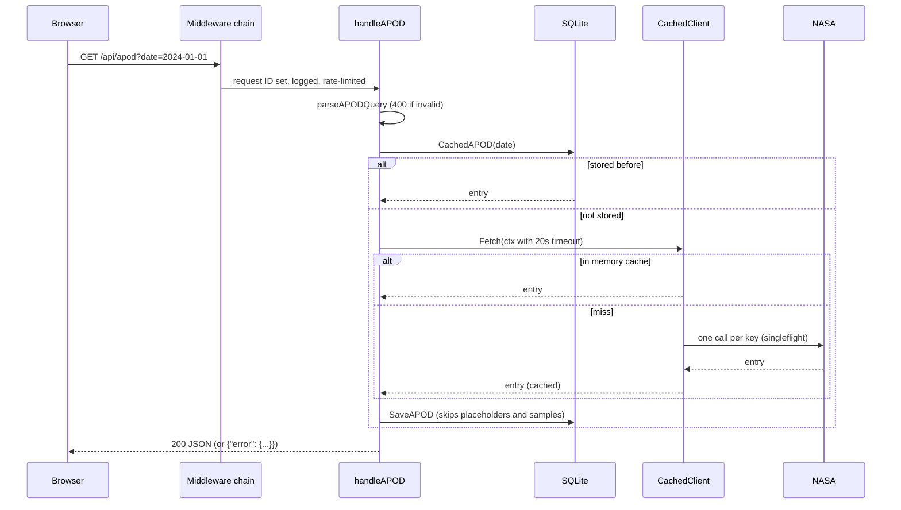

# Architecture

This document explains how a request moves through the server, why the cache uses `singleflight`, how the goroutines fit together, how the server shuts down, and the reasoning behind the security choices. File references point at where each idea lives in the code.

## 1. Request lifecycle

Take `GET /api/apod?date=2024-01-01` from the browser.



**1. Middleware** (`internal/httpapi/middleware.go`). The chain is built in `Server.Handler`, outermost first:

| Middleware | Why it's in this position |
|---|---|
| Request ID | First, so every later log line can include it. Accepts a safe incoming `X-Request-ID` or generates one. |
| Security headers | CSP, `nosniff`, `Referrer-Policy`, frame denial on every response, errors included. |
| Logging | One structured `slog` line per request: method, path, status, bytes, duration, request ID. |
| Panic recovery | Inside logging, so a recovered panic is still logged as a 500. |
| CORS | Only the configured origin gets CORS headers; preflights from others get 403. |
| CSRF origin check | Unsafe methods with a foreign `Origin` header get 403. |
| Rate limiting | Last, so throttled requests are still logged and still carry security headers. |

**2. Validation** (`internal/httpapi/validate.go`).
- `parseAPODQuery` accepts exactly one form: nothing, `date`, a `start_date`/`end_date` pair, or `count`.
- Dates must parse strictly as `YYYY-MM-DD` and fall between 1995-06-16 and *today in New York*. NASA's day changes over in US Eastern time, so a user in India asking for "today" after midnight local time would otherwise get an upstream error.
- Failures return 400 with a stable `code` and a readable `message` (`internal/httpapi/errors.go`).

**3. Three layers of data**, cheapest first:
1. **SQLite** (`Store.CachedAPOD`): a past APOD never changes, so once stored it is served forever.
2. **The in-memory TTL cache** inside `apod.CachedClient`.
3. **NASA**, through `singleflight` (section 2).

**4. Context and timeouts.**
- The handler derives `context.WithTimeout(r.Context(), 20s)`. If the client disconnects or the server shuts down, the wait is abandoned; a slow upstream can't hold the handler past 20 seconds.
- The **shared** upstream fetch uses its own 25-second timeout on a context detached from any one caller (section 2).
- Upstream timeouts become **504** and other upstream failures **502**, both with JSON bodies.

**5. Response.** Single dates return a JSON object; ranges and random counts return arrays, matching NASA's own shapes.

## 2. The cache and `singleflight`

### The problem: cache stampede

A cache only helps after the first fetch. At the moment a popular key is missing, the first request after a deploy or right after expiry, every request that arrives before the first upstream call returns also sees a miss. Each of them calls NASA:

```
t=0ms    request 1: miss -> calls NASA ----------------------\
t=1ms    request 2: miss -> calls NASA --------------------\  |
...                                                         |  |
t=40ms   request 100: miss -> calls NASA -\                 |  |
t=900ms  responses arrive  <---------------+---------------+--+   100 identical calls
```

100 identical calls waste time and, on NASA's shared `DEMO_KEY`, burn through the rate limit, so the app then fails for everyone.

### The fix

`internal/apod/cached.go` wraps the upstream client in a `singleflight.Group`. For a given key, only the first caller runs the fetch; everyone who arrives while it's in flight waits for that same result:

```
request 1:   miss -> starts the fetch for key K --------\
request 2:   miss -> joins the fetch for K               |   1 call to NASA
...                                                      |
request 100: miss -> joins the fetch for K               |
             all 100 receive the one result <------------/
```

Details that matter, all in `CachedClient.Fetch`:

1. **Fast path first.** A cache hit returns immediately and never touches the `singleflight` group.
2. **Check again inside the flight.** Between a caller's miss and its `DoChan` call, a previous flight may have just finished and filled the cache. Re-checking inside the function avoids a second, redundant fetch.
3. **The shared fetch is detached from the first caller.** It runs on `context.WithoutCancel(ctx)` plus a 25-second timeout. Without this, if user 1 closed their tab, their cancelled context would kill the fetch for users 2–100 as well.
4. **Each waiter can still give up on its own.** `DoChan` returns a channel, and each caller `select`s on it and on its own `ctx.Done()`. A caller that gives up returns `ctx.Err()`, and the fetch carries on for the others and still fills the cache.
5. **Errors are never cached.** The next request retries.
6. **Random queries skip all of this.** `?count=N` should return different pictures each time, so it bypasses both the cache and `singleflight`. (It used to be cached, so infinite scroll kept repeating the same images.)

The space-facts summary uses the same pattern (`internal/spacefacts`), since every page load asks for the same single key.

### The cache itself

`internal/cache/cache.go` is a generic `Cache[K, V]`:

- **Locking.** A `sync.RWMutex` guards the map. Many readers can hold the read lock at once; writers take the exclusive lock. Go maps aren't safe for concurrent writes, and without the lock the program would crash with "concurrent map writes".
- **Expiry.** Each entry has its own expiry (`SetWithTTL`).
- **Reads never delete.** `Get` only takes the read lock, so it treats an expired entry as a miss without removing it. Deleting would need the write lock and make every read contend with writers.
- **Cleanup.** The memory is reclaimed by `DeleteExpired`, which the janitor goroutine (`RunJanitor`, a `time.Ticker` loop) calls every minute until its context is cancelled.
- **Testable clock.** The clock is a field (`now func() time.Time`), so tests move time forward instead of sleeping.

## 3. Concurrency model

| Goroutine | Started by | Lifetime | Stops when |
|---|---|---|---|
| One per HTTP request | `net/http` | the request | handler returns |
| APOD cache janitor | `run` in `cmd/server` | process | root context cancelled |
| Space-facts cache janitor | `run` | process | root context cancelled |
| Rate-limiter cleanup (drops idle IPs) | `Server.RunBackground` | process | root context cancelled |
| Expired-session purge (hourly) | `Server.RunBackground` | process | root context cancelled |
| `singleflight` fetches | first caller of a key | one upstream call | fetch returns or times out (25s) |
| "On this day" fetches | `handleOnThisDay` (`errgroup`, at most 4 at once) | one request | all years fetched |

**Shared state:**

| State | Protected by |
|---|---|
| Caches | `sync.RWMutex` |
| Rate limiter map | `sync.Mutex` (each `rate.Limiter` is itself goroutine-safe) |
| Sessions and everything else persistent | SQLite, accessed through `database/sql`'s connection pool. WAL mode lets readers proceed during a write, and `busy_timeout` waits for locks instead of failing. |

Handlers keep no mutable globals.

**Why plain `errgroup.Group` for "on this day".** The handler needs one upstream call per year, so they run concurrently with `g.SetLimit(4)` so one request can't flood NASA. It uses a plain `errgroup.Group` rather than `errgroup.WithContext`: `WithContext` cancels everything on the first error (fail-fast), but a missing year should simply be skipped. Each goroutine writes only its own slot in a results slice, so the order is preserved without a mutex.

**Checked with the race detector.** CI runs every test under `-race`, including a test that hammers the cache from 50 goroutines and the 100-goroutine `singleflight` test.

## 4. Graceful shutdown

`cmd/server/main.go`:

1. `signal.NotifyContext` turns SIGINT (Ctrl+C) or SIGTERM (what Docker, Kubernetes and Fly.io send) into a cancelled root context.
2. `serve` notices, and calls `http.Server.Shutdown` with a **fresh** 15-second context, because the root one is already cancelled. `Shutdown` stops accepting connections, closes idle ones, and waits for in-flight requests to finish.
3. `Serve` then returns `http.ErrServerClosed`, which counts as success.
4. Because the root context is cancelled, the janitors and cleanup loops exit; `run` waits for them with a `sync.WaitGroup`.
5. Only then does the deferred `db.Close()` run, so no goroutine touches a closed database.

`TestServeDrainsInFlightRequests` proves step 2: a request that is mid-flight when the stop signal arrives still gets its full response, and `serve` doesn't return until it has. In the container, `docker stop` exits in about a second with "server stopped cleanly" in the logs, instead of being killed after Docker's 10-second grace period.

**Server timeouts.** The `http.Server` sets all four timeouts explicitly, because without them `net/http` waits forever and a slow client can tie up connections indefinitely (slowloris):

| Timeout | Value | Covers |
|---|---|---|
| `ReadHeaderTimeout` | 5s | sending the request headers |
| `ReadTimeout` | 15s | sending the whole request |
| `WriteTimeout` | 30s | producing the response; above the 20s upstream wait, so the client always gets a proper JSON error |
| `IdleTimeout` | 120s | an idle keep-alive connection |

## 5. Security choices

| Concern | What the app does | Where |
|---|---|---|
| **Passwords** | bcrypt (slow and salted per password); 8–72 characters, since bcrypt ignores bytes past 72. Old SHA-256 hashes are compared in constant time and upgraded on login. | `httpapi/auth.go` |
| **Username probing** | Unknown users and wrong passwords get the same 401 message. Unknown users also run a dummy bcrypt comparison, so timing doesn't reveal which usernames exist. | `httpapi/auth.go` |
| **Session tokens** | 256 bits from `crypto/rand`, in a cookie that is `HttpOnly` (page scripts can't read it, so XSS can't steal it), `Secure` (HTTPS only) and `SameSite=Lax` (not sent on cross-site POSTs). | `httpapi/auth.go` |
| **Stored sessions** | Only `HMAC-SHA256(SESSION_SECRET, token)` is stored, so a leaked database can't be replayed as cookies. Logout deletes the row, so a copied cookie stops working. Expired sessions are purged hourly. | `store`, `httpapi/auth.go` |
| **CSRF** | SameSite cookies; an `Origin` check on unsafe methods; bodies must be `application/json`, which an HTML form on another site can't send without a CORS preflight. | `httpapi/middleware.go`, `server.go` |
| **CORS** | No `Access-Control-Allow-Origin: *`. Only same-origin, or one configured `APP_ORIGIN`. | `httpapi/middleware.go` |
| **Rate limiting** | A token bucket per client IP on `/api/` (`x/time/rate`), 429 with `Retry-After`. The client IP comes from the connection, or a configured trusted proxy header such as `Fly-Client-IP`, never from `X-Forwarded-For`, which any client can forge. Idle IPs are forgotten so memory doesn't grow forever. | `httpapi/middleware.go` |
| **SQL injection** | Every query uses `?` placeholders. Where a column name varies, each variant is its own constant statement, since placeholders can't stand in for identifiers. A test feeds a classic injection string and checks it matches nothing. | `internal/store` |
| **XSS** | The frontend never uses `innerHTML` for API data; everything goes in as text. The CSP forbids inline and eval'd script, so even injected markup couldn't run. Video embeds are limited to YouTube's privacy-enhanced domain and Vimeo. | `web/static/js`, `middleware.go` |
| **Secret leakage** | Upstream transport errors are unwrapped before logging, because Go's `*url.Error` includes the full URL with `?api_key=`. A test checks the key never appears. Other keys travel in headers, not URLs. | `internal/apod/apod.go` |
| **Input size** | JSON bodies are capped at 1 MiB, and unknown fields are rejected. Upstream bodies are read through a size limit. | `server.go`, `apod.go` |
| **Container** | Distroless runtime image: no shell or package manager, non-root user. | `Dockerfile` |

## 6. Data model

Migrations are plain `.sql` files in `internal/store/migrations/`, embedded with `go:embed`. On startup each one runs exactly once, in order, inside a transaction together with its `schema_migrations` row.

| Migration | What it adds |
|---|---|
| `0001_initial_schema.sql` | `users`, `favorites` (`UNIQUE(user_id, apod_date)`, so a day can't be saved twice), `history`, `comments`, `ratings` (`UNIQUE(user_id, image_date)`), `image_stats`, and `apod_cache`, the permanent copy of entries |
| `0002_sessions.sql` | `sessions`: token HMAC, user, created and expiry times as Unix seconds; plus indexes for per-user queries |
| `0003_apod_media_fields.sql` | credit (`copyright`) and video `thumbnail_url` on cached entries |

## 7. Frontend

Plain HTML, CSS and native ES modules in `web/static/`, embedded into the binary.

| Module | Responsibility |
|---|---|
| `app.js` | State, rendering, the viewer and accounts |
| `api.js` | Turns every failure into an `ApiError` with the server's message |
| `dom.js` | Safe element builder (text only) and date helpers |
| `media.js` | Images, video embeds and thumbnails |
| `favorites.js` | Server or `localStorage` favorites, synced on login |
| `starfield.js` | The animated background |

The viewer uses a native `<dialog>` (focus handling, Esc, an inert background) and toasts use `popover`, so they appear above the open dialog in the browser's top layer.
